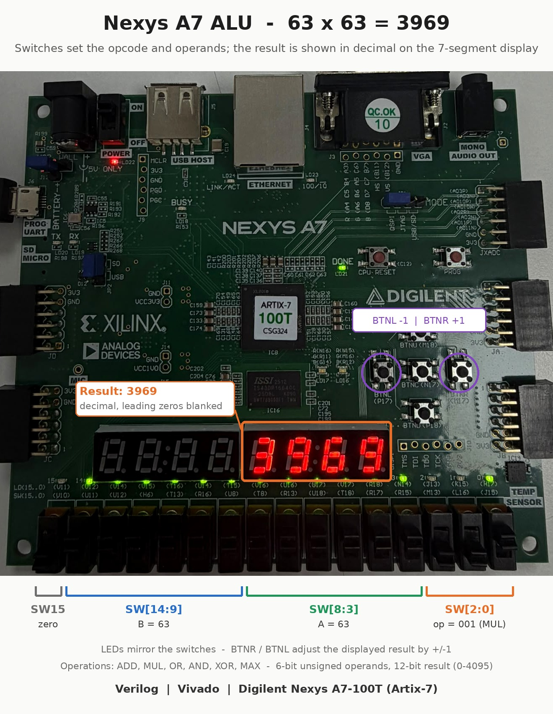
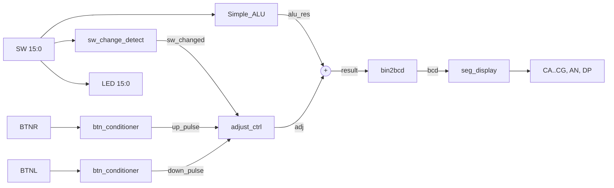
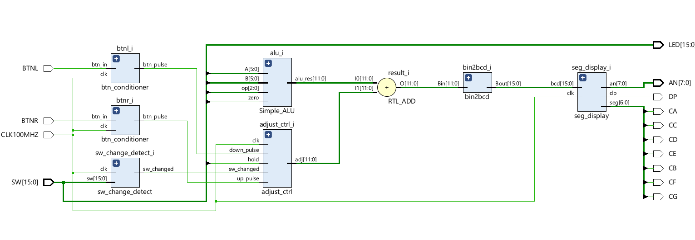
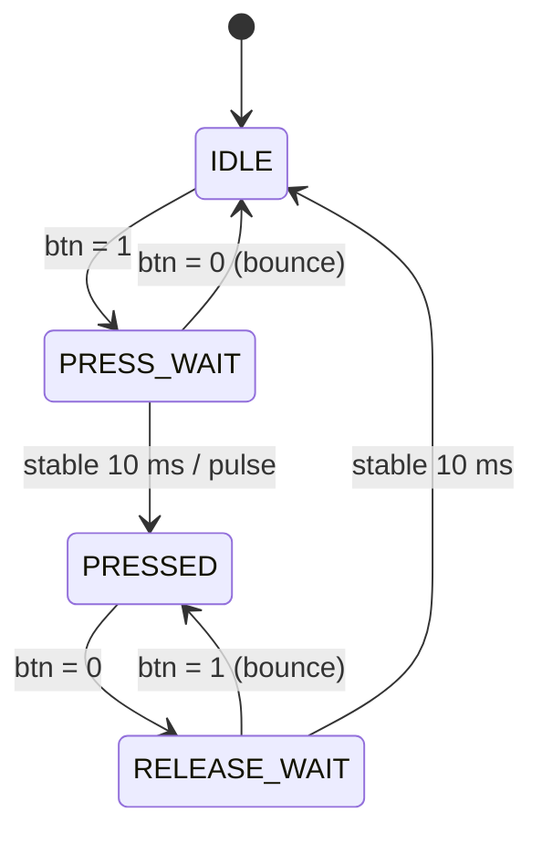
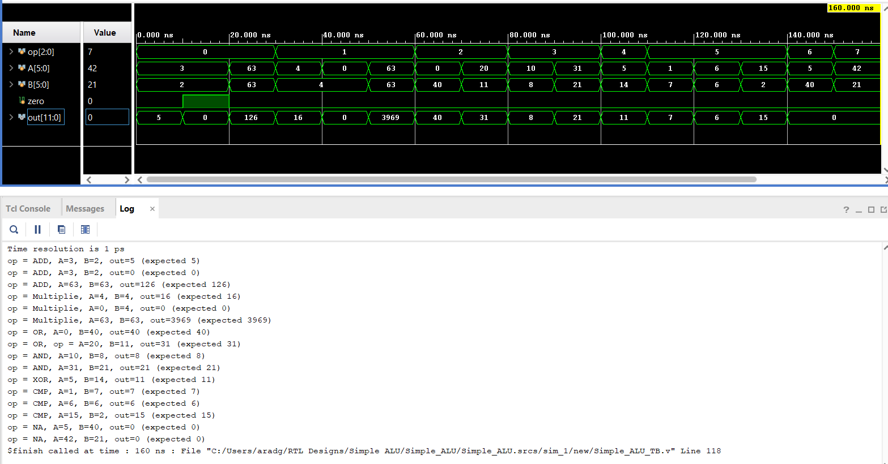
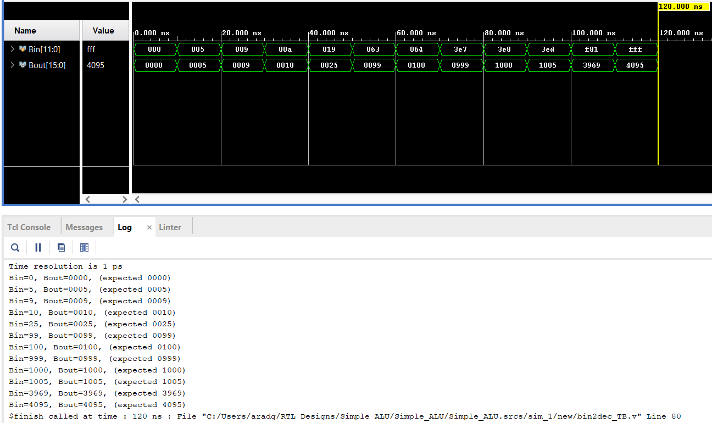
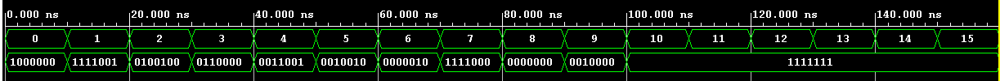
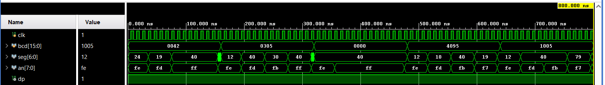
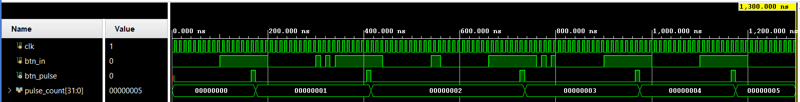
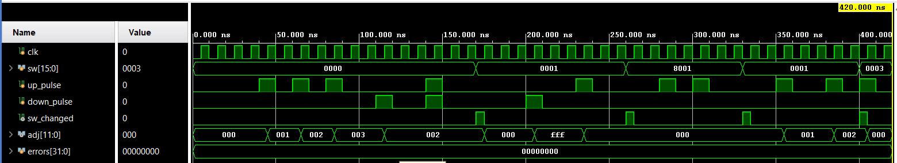

# Nexys A7 ALU with Decimal 7-Segment Display

A small FPGA design for the **Digilent Nexys A7-100T**: a 6-operation ALU driven by the slide switches, with the result shown in **decimal** on the 7-segment display and adjustable by **±1** with the push buttons.

Written in Verilog, simulated in Vivado xsim, and tested on the board.



## Features

- 6-operation ALU on two 6-bit unsigned operands (ADD, MUL, OR, AND, XOR, MAX)
- 12-bit result (0–4095) converted to decimal with a combinational **double-dabble** converter
- 4-digit **time-multiplexed** display with **leading-zero blanking**
- **BTNR / BTNL** add / subtract 1 from the displayed result (12-bit wrap-around)
- Button inputs pass through a **2-FF synchronizer** and a **debounce FSM**: exactly one step per physical press, no auto-repeat
- Any switch change resets the ±1 correction; **SW[15]** forces the result to 0 and freezes the buttons
- LEDs mirror the switches

## Board interface

| Input / Output | Function |
|---|---|
| `SW[2:0]` | Opcode |
| `SW[8:3]` | Operand A (unsigned, `SW[3]` = LSB) |
| `SW[14:9]` | Operand B (unsigned, `SW[9]` = LSB) |
| `SW[15]` | Zero: result = 0, buttons ignored |
| `BTNR` | +1 on the displayed result |
| `BTNL` | −1 on the displayed result |
| `LED[15:0]` | Mirror `SW[15:0]` |
| 7-segment | Result in decimal, digits AN0–AN3 |

| Opcode | Operation | Result range |
|---|---|---|
| `000` | A + B | 0 – 126 |
| `001` | A × B | 0 – 3969 |
| `010` | A OR B | 0 – 63 |
| `011` | A AND B | 0 – 63 |
| `100` | A XOR B | 0 – 63 |
| `101` | max(A, B) | 0 – 63 |
| `110`, `111` | unused | 0 |

## Architecture





*Vivado elaborated schematic of the display path (before the button logic was added).*

| Module | Type | Description |
|---|---|---|
| `Simple_ALU` | Combinational | Operations on zero-extended 12-bit operands; `zero` overrides the opcode |
| `bin2bcd` | Combinational | 12-bit binary → 4 BCD digits (shift-and-add-3, unrolled loop) |
| `seg_decoder` | Combinational | BCD digit → active-low segment pattern |
| `seg_display` | Sequential | Refresh counter, digit select, leading-zero blanking, anode drive |
| `btn_conditioner` | Sequential + FSM | Synchronizer + debounce FSM → one-cycle pulse per press |
| `sw_change_detect` | Sequential | One-cycle pulse when any switch changes |
| `adjust_ctrl` | Sequential | ±1 correction register with priority logic |
| `alu_top` | Structural | Board-level integration |

## Design notes

**Display multiplexing.** The eight digits share the segment lines (CA–CG), so only one digit can be driven at a time. A 19-bit free-running counter at 100 MHz uses its top two bits to rotate through the four used digits every ~1.3 ms (~190 Hz full refresh, no visible flicker). Everything runs on the single 100 MHz clock; no derived clocks.

**Button debounce FSM.** `IDLE → PRESS_WAIT → PRESSED → RELEASE_WAIT`. A press must be stable for `DEBOUNCE_CYCLES` (10 ms) before the single output pulse is issued. Bounces during release return to `PRESSED`, so they can never be counted as a new press.



**Correction priority** (`adjust_ctrl`, evaluated every clock): switch change → reset, else SW[15] → hold, else single up → +1, else single down → −1, else no change. Both buttons in the same cycle cancel out.

**No reset button.** All registers have initial values that Vivado loads at configuration. Testbenches rely on the same initial values.

**Parameters for simulation.** `DEBOUNCE_CYCLES` and `REFRESH_BITS` are parameters, so the testbenches override them (4 cycles) instead of simulating 10 ms and 5 ms.

**Known limitation (documented).** The switches feeding `sw_change_detect` are not synchronized. A rare metastable sample could miss or duplicate a correction reset; the ALU datapath itself is unaffected. A 2-FF synchronizer per switch would remove this risk.

**Lint.** One intentional message remains: `bin2bcd` does not read `count[11:0]` (the input area is always zero after the last shift).

## Verification

Each module has its own testbench (Vivado xsim):

| Testbench | What it checks | Result |
|---|---|---|
| `Simple_ALU_TB` | 16 cases: all operations, 126 / 3969 limits, ×0, CMP with A>B, A<B, A=B, unused opcodes, `zero` | All pass |
| `bin2bcd_TB` | 0, 5, 9, 10, 25, 99, 100, 999, 1000, 1005, 3969, 4095 | All pass |
| `seg_decoder_TB` | All 16 codes (0–9 patterns, 10–15 blank) | All pass |
| `seg_display_TB` | AN rotation, patterns, blanking for 0042 / 0305 / 0000 / 4095 / 1005 | Verified on waveform |
| `btn_conditioner_TB` | Clean press, bouncing press, short glitch, bouncing release, two presses | 5 pulses as expected |
| `adjust_ctrl_TB` | Self-checking: accumulate, both buttons, switch reset, wrap 0↔4095, hold, reset priority | ALL TESTS PASSED |

| | |
|---|---|
|  |  |
|  |  |





Hardware test on the board: all operations, decimal display with blanking, ±1 per press (no double counts), reset on switch change, wrap-around to 4095, SW[15] hold.

## Design process

The project followed a staged flow before writing RTL: requirements spec → basic block diagram → FSM and register list → detailed block diagram with signals → detailed state table → timing waveforms → module-by-module RTL with a testbench for each → integration → board test.

## Repository layout

```
rtl/          Verilog source (alu_top is the top level)
tb/           Testbenches
constraints/  Nexys A7-100T pin constraints
docs/images/  Screenshots and board photo
```

## Build

1. Vivado (tested with 2025.1): create an RTL project for part `xc7a100tcsg324-1`.
2. Add `rtl/*.v` as design sources, `tb/*.v` as simulation sources, `constraints/nexys_a7_100t.xdc` as constraints.
3. Set `alu_top` as the top module and run **Generate Bitstream**.
4. Program the board from Hardware Manager.

To run a testbench, set it as the simulation top. `btn_conditioner_TB` runs ~1.3 µs, so set the xsim run time to `all`.
